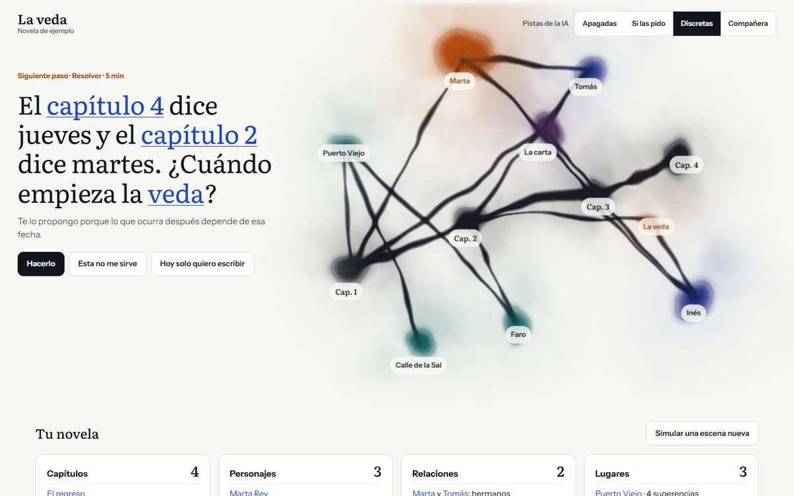

# Ink Writer

**English** · [Español](README.es.md)

An offline desktop app for writing novels. **You write every word.** The AI builds the sheets for your story, watches its coherence, suggests small next steps and researches what you need.

Status: version 0.1.0, not released yet. The installers are not signed for Windows or macOS yet, so installing shows a security warning: see the [guide](docs/guia.md#avisos-al-instalar) (in Spanish).



## What it does

- **Write** in a distraction-free editor, with continuous saving, per-scene history and export to Word and Markdown.
- **Sheets** for characters, places and lore, which the AI builds from your text. Every fact links to the passage it comes from.
- **Hints** about what does not fit, gradual and adjustable, down to switching them off.
- **Research** on places, period and topics, from OpenStreetMap, Open-Meteo and Wikipedia. Every result shows its source.
- **Start screen** with the novel as a network of ink and one next step.

The AI is optional and you choose it: a local model with Ollama, or a cloud one through OpenRouter or DeepSeek. No telemetry.

## How this project is built

The repository is spec-driven, and the documents are part of the work. Most are written in Spanish.

| Document | What it holds |
|---|---|
| [SPEC.en.md](SPEC.en.md) | The product specification: principles, screens, the analysis pipeline and what the AI may and may not do. English translation of [SPEC.md](SPEC.md). |
| [ROADMAP.md](ROADMAP.md) | The plan by milestones. Each one has an exit criterion it must meet before the next starts. |
| [fixtures/](fixtures/README.md) | The evaluation set for the AI analysis. `npm run eval` scores a model against it, and a milestone only closes when the thresholds are met with at least two models. |
| [docs/adr/](docs/adr/) | 21 architecture decision records: Tauri with a TypeScript core, Yjs and SQLite, the AI routes, encrypted sync, distribution. |
| [DESIGN.md](DESIGN.md) | Visual direction, with a [demo](docs/design/ink-demo/index.html). |
| [CLAUDE.md](CLAUDE.md) | Instructions and commands for working on the project with Claude Code. |
| [CONTRIBUTING.md](CONTRIBUTING.md) · [SECURITY.md](SECURITY.md) · [docs/publicar.md](docs/publicar.md) | Contributing, security and how to publish a release. |

User guide: [docs/guia.md](docs/guia.md).

## Development

Requires Node 24 and stable Rust, plus the [Tauri prerequisites](https://tauri.app/start/prerequisites/) for your system.

```sh
npm install
npm run dev     # opens the app
npm test        # TypeScript and Rust tests
```

## License

MIT. See [LICENSE](LICENSE). Third-party components bundled with the app are listed in [THIRD-PARTY-NOTICES.md](THIRD-PARTY-NOTICES.md).
